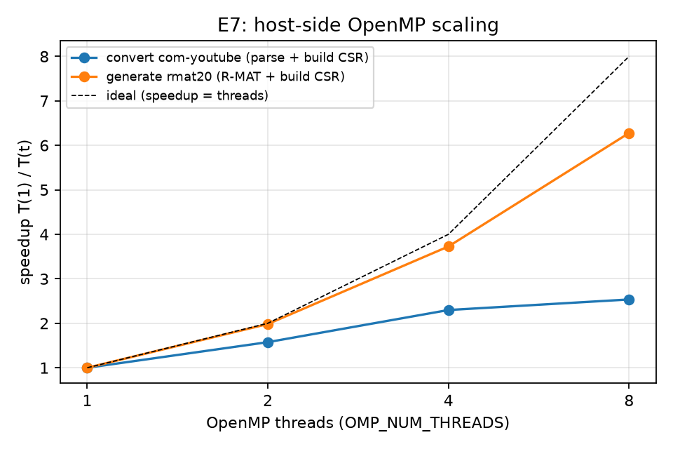

# 3.4 OpenMP usage on the host

*(Owner: Member 1. E7 numbers from `results/omp_scaling.csv`, measured on the development machine; re-run
`scripts/omp_scaling.sh` on the reference machine and update this section if the final report must use only
reference-machine numbers.)*

The synopsis uses OpenMP for the CPU work around the GPU kernels. Table 3.4 lists every place it is used.

*Table 3.4: OpenMP inventory.*

| Where | What runs in parallel | OpenMP constructs | Owner |
|-------|-----------------------|-------------------|-------|
| `graph_io.cpp`: `load_edge_list` | text parsing in byte chunks, id compaction, edge renumbering | `parallel`, `parallel for` | M1 |
| `graph_io.cpp`: `build_csr_from_edges` | degree count, scatter, per-vertex sort/dedupe, compaction | `parallel for`, `atomic update`, `atomic capture`, `schedule(dynamic)` | M1 |
| `graph_gen.cpp`: `make_rmat` | edge generation in deterministic blocks | `parallel for` | M1 |
| `validate.cpp` | result comparison, structural validation, edge counting | `parallel for`, `reduction` | M1 |
| `bench.cu` | validation and CSV writing of run i overlap the GPU execution of run i+1 | `parallel`, `single`, `task`, `taskwait`, `critical` | M2 |
| adaptive driver | GPU kernels of three buckets overlap using CUDA streams (host launches only) | (CUDA streams, not OpenMP) | M3 |

**Experiment E7: host preprocessing scaling.** We timed two preprocessing tasks with 1, 2, 4 and 8 OpenMP
threads: converting com-youtube from text (38.7 MB, parse + build CSR) and generating rmat20 (R-MAT + build
CSR). The script makes one untimed warm-up read of the input first: without it, the 1-thread conversion
included reading the file from disk (1,581 ms instead of about 500 ms) and showed a misleading, superlinear
5x speedup at 2 threads.

*Table 3.5: E7 results (development machine: Intel Core i5-12450H, 8 cores / 12 threads, WSL2; 16 threads
skipped because the machine has 12 logical CPUs).*

| threads | convert com-youtube (ms) | speedup | rmat20 (ms) | speedup |
|---------|--------------------------|---------|-------------|---------|
| 1 | 458.9 | 1.00 | 9,715.7 | 1.00 |
| 2 | 291.2 | 1.58 | 4,899.5 | 1.98 |
| 4 | 199.7 | 2.30 | 2,606.9 | 3.73 |
| 8 | 181.0 | 2.54 | 1,547.8 | 6.28 |

*Figure 3.4: Speedup T(1)/T(t) of host preprocessing versus OpenMP threads; dashed line = ideal.*

R-MAT generation scales well (6.3x on 8 threads, 78% efficiency): it is pure computation on independent edge
blocks, and only the final CSR build has serial parts. Text conversion scales poorly (2.5x on 8 threads, 32%
efficiency), and most of the gain comes from the first 4 threads. Parsing is limited by memory bandwidth, and
the id-compaction pass and the two prefix sums are serial, so by Amdahl's law they cap the speedup. Run-to-run
variation was noticeable: in three repetitions the 2-thread rmat20 time ranged from 4.5 s to 5.9 s. This is a
laptop CPU with performance and efficiency cores, so 8 threads mix fast and slow cores. All of this is host-side
preprocessing, which is never inside the timed BFS region (Section 4).
